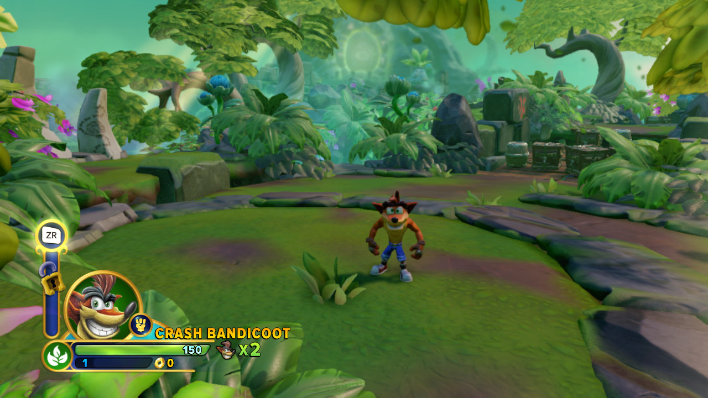
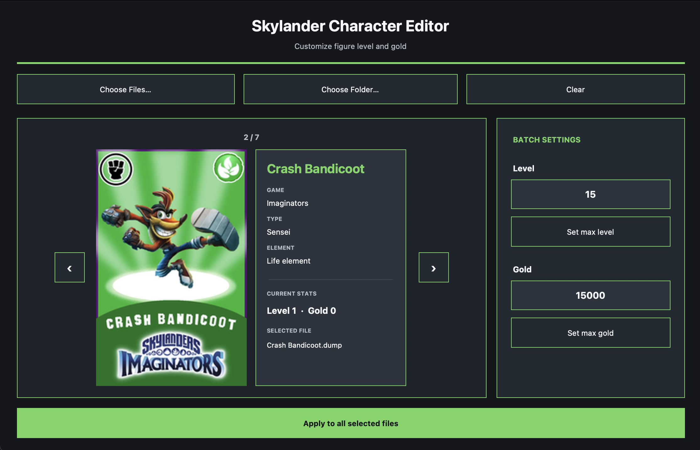
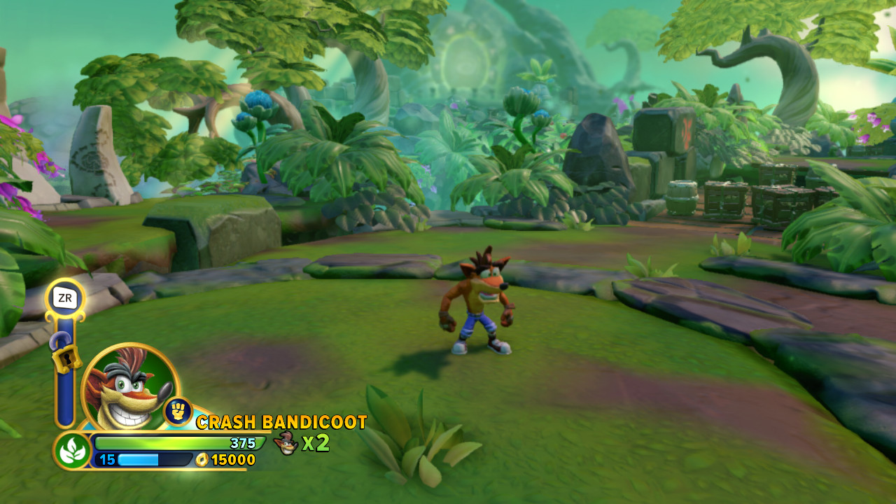

# Skylander Character Editor

A desktop utility for inspecting and editing level/XP and gold values in 1,024-byte Skylanders character `.sky` and `.dump` files.

> **Compatibility note:** The editor has been verified end-to-end with a Trap Team **Short Cut** dump. Additional supplied Trap Team dumps were used to test zero-block handling and parsing. It has **not** been comprehensively validated against every character and every Skylanders game. Back up your dumps before use. Fresh-save initialization supports recognized standard character figures across generations, but successful internal readback does not prove every game will accept the new save.


## Features

- Select one `.sky` or `.dump` file, multiple files, or a folder containing either extension.
- Drag `.sky`/`.dump` files onto **Choose Files** or a folder onto **Choose Folder**; the target shows a large plus while a supported item is dragged over it.
- Preview recognized figures one at a time with previous/next controls, including character portraits, name, generation, type, and element; batch settings still apply to every selected file.
- Keep the original dark interface with a high-contrast element-colored accent.
- Apply a common level (1–20) and gold amount (0–65,000) to a batch.
- Choose **Create copies** (the default) or **Edit files in place** before applying changes. Copies are saved beside originals with a `_copy` suffix; a number is added if that name already exists.
- Decrypt/encrypt data blocks using AES-128 ECB with MD5-derived per-block keys.
- Detect literal-zero blocks rather than treating them as ciphertext.
- Validate the editor's supported redundant save areas using CRC-16 checksums and sequence counters.
- Re-read generated output and check the requested XP/gold values before saving the copy or replacing the original.
- Fresh-save initialization for recognized standard characters across the supported generations.

## See it in action

The screenshots below show Crash Bandicoot before editing, the selected level and gold in the editor, and the updated values in *Skylanders Imaginators*.

| Before editing | Set values in the editor | After editing |
| --- | --- | --- |
| Level 1 · 0 gold | Level 15 · 15,000 gold | Level 15 · 15,000 gold |
|  |  |  |

## Compatibility

The intended scope is standard playable character figures from:

- *Skylanders: Spyro's Adventure*
- *Skylanders: Giants*
- *Skylanders SWAP Force*
- *Skylanders: Trap Team*
- *Skylanders: SuperChargers*
- *Skylanders: Imaginators*

**Intended scope is not the same as verified compatibility.** The code assumes a shared standard-character save layout, but full coverage of every generation, character variant, and figure state has not been established. Figures with unfamiliar or inconsistent data may fail validation. Traps, vehicles, Creation Crystals, and adventure/magic items are out of scope. SWAP Force figures have special considerations and should be tested individually.

## Download a release

Open the repository's **Releases** page and download the installer matching your operating system. Each release provides:

- `Skylander-Character-Editor-macos-arm64.dmg` for Apple Silicon Macs.
- `Skylander-Character-Editor-macos-x86_64.dmg` for Intel Macs.
- `Skylander-Character-Editor-windows-x86_64-Setup.exe` for 64-bit Windows.
- `Skylander-Character-Editor-linux-x86_64.AppImage` for 64-bit Linux (Ubuntu 22.04 or a compatible distribution).

The macOS disk image opens a drag-to-Applications window. The Windows setup program installs the app and creates a Start Menu shortcut, with an optional desktop shortcut. On Linux, mark the AppImage executable in its file properties (or run `chmod +x Skylander-Character-Editor-linux-x86_64.AppImage`), then double-click it to launch.

These packages are built and attached automatically when a version tag such as `v1.0.0` is pushed. GitHub Actions runs the build and tests for all four platforms; the release appears after every platform build succeeds.

### macOS first launch

The macOS build is not Developer ID signed or notarized by default. macOS may show a security warning. You may need to Control-click the app and choose **Open** the first time. A signed and notarized release requires an Apple Developer ID certificate and notarization credentials configured as GitHub Actions secrets.

The Windows installer is not code-signed by default, so Windows SmartScreen may show an unknown-publisher warning. A trusted publisher signature requires a code-signing certificate configured for the release workflow.

## Run from source

Requires Python 3.10+ and Tk support in the Python installation.

```bash
python -m venv .venv
```

Activate the environment:

**macOS / Linux**
```bash
source .venv/bin/activate
```

**Windows PowerShell**
```powershell
.venv\Scripts\Activate.ps1
```

Install dependencies and launch:

```bash
python -m pip install -r requirements.txt
python src/skylander_character_editor.py
```

## Build locally

Install the development dependencies:

```bash
python -m pip install -r requirements-dev.txt
```

Then run PyInstaller on the operating system you want to build for:

```bash
pyinstaller --noconfirm --clean --windowed --name "Skylander Character Editor" --collect-all cryptography --collect-all tkinterdnd2 --add-data "assets:assets" src/skylander_character_editor.py
```

Build separately on each target OS; PyInstaller is not a cross-compiler.

## Data safety

- **Create copies is selected by default.** Copies are saved beside the originals with a `_copy` suffix. Choose **Edit files in place** only when you intend to replace the selected originals.
- Back up your `.sky` and `.dump` files before editing, especially when choosing in-place edits.
- Do not run batch edits on your only copy of a collection.
- A successful internal checksum/readback test does not prove that a physical figure or every game will accept a dump.
- Fresh-save initialization is limited to recognized standard character figures. It does not initialize traps, vehicles, Creation Crystals, adventure items, or unknown IDs.
- Keep a backup and verify newly initialized figures in the intended game; in-app readback checks the data structure and requested XP/gold, not game acceptance.
- This project is an independent community tool and is not affiliated with or endorsed by Activision or the Skylanders franchise owners.

## Technical overview

The application treats `.sky` and `.dump` as filename extensions for the same expected 1,024-byte data format; it does not recognize any alternate `.dump` encoding or wrapper. Its bundled catalog contains character IDs, metadata, and portrait PNGs for recognized figures. It derives AES keys from the figure header, block index, and a fixed Activision format constant using MD5, and transforms selected 16-byte blocks with AES-128 ECB. It evaluates redundant save areas with CRC-16 checksums and sequence counters, writes XP/gold fields, regenerates the supported checksums, encrypts the result, then decrypts and reads it back for verification. Batch writes first use a temporary sibling file; validated results are then saved as copies by default or replace the original when in-place editing is selected.

Portraits and character metadata are community assets bundled from [Emulanders](https://github.com/joaohypo/emulanders/releases) and [Skylanders Collector](https://github.com/Karasu-huginn/Skylanders_Collector). See `assets/README.txt` for attribution and the upstream asset licensing caveat. The packaged application includes approximately 51 MB of portrait assets.

## Contributing

See [CONTRIBUTING.md](CONTRIBUTING.md). Please include reproducible test details and never submit personal NFC dumps without permission from their owner. The [changelog](docs/CHANGELOG.md) and [release checklist](docs/RELEASE_CHECKLIST.md) are in `docs/`.
